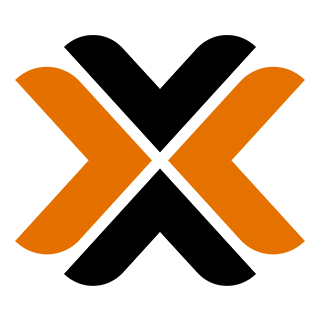
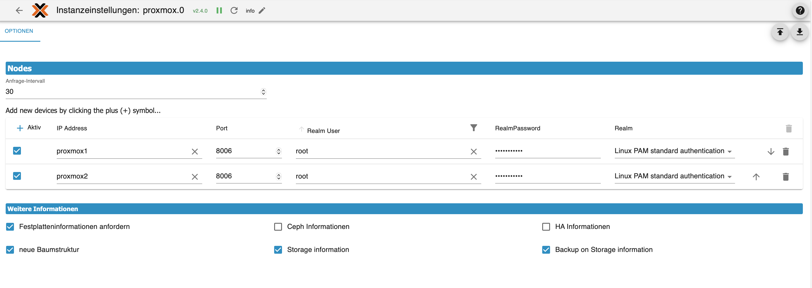
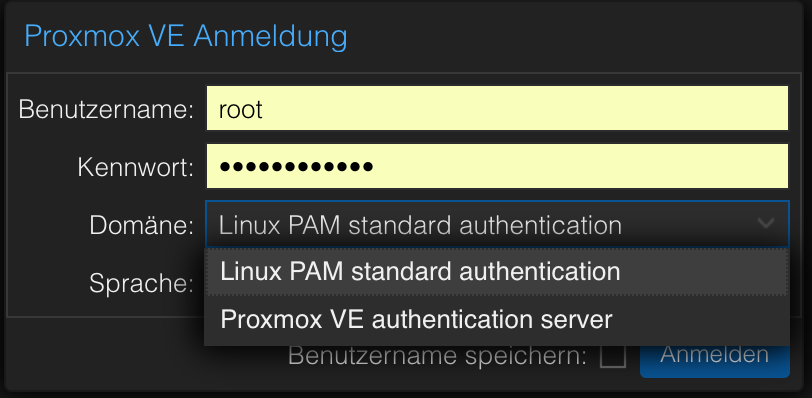
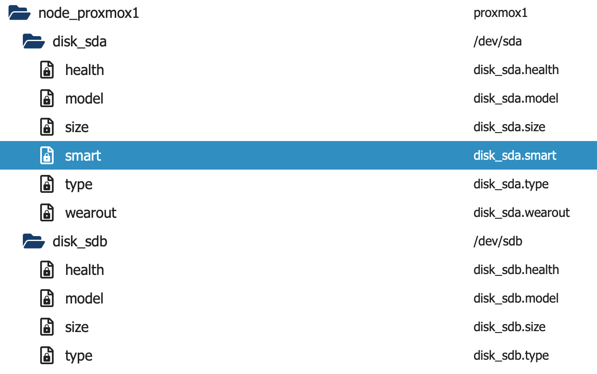
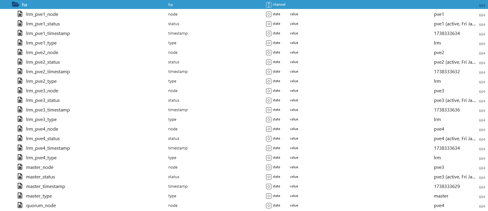
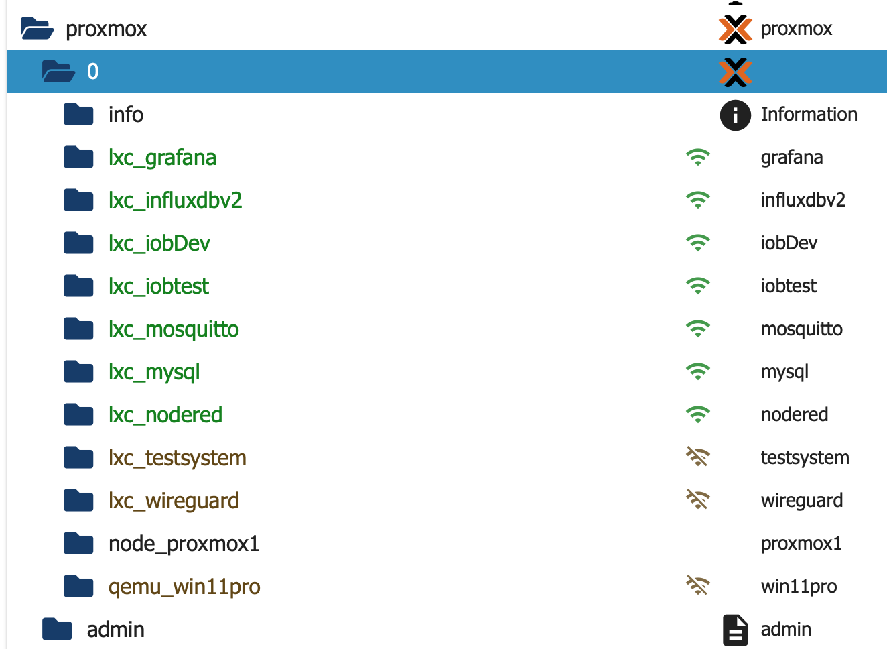
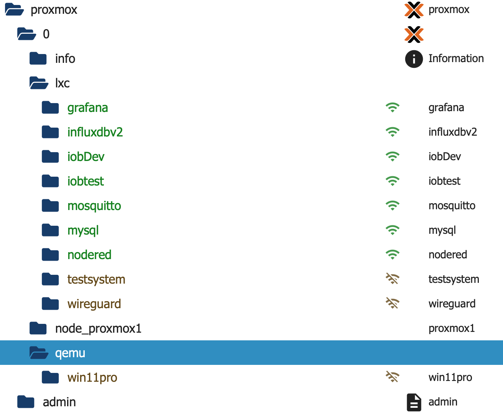
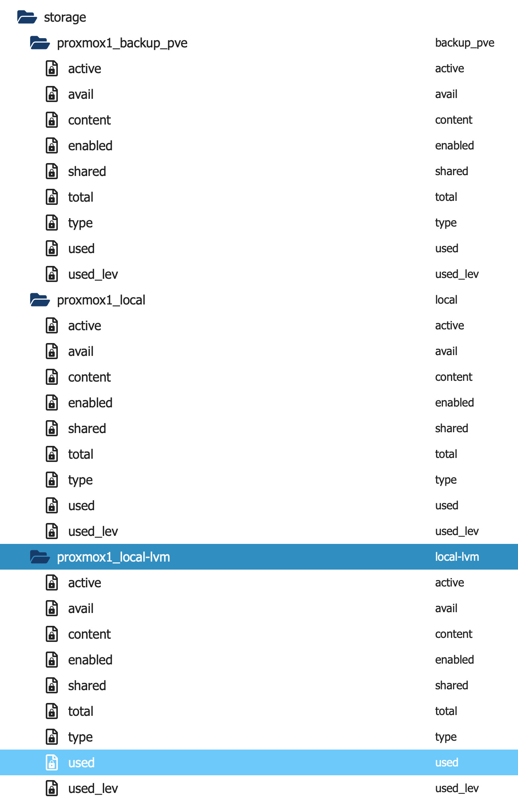
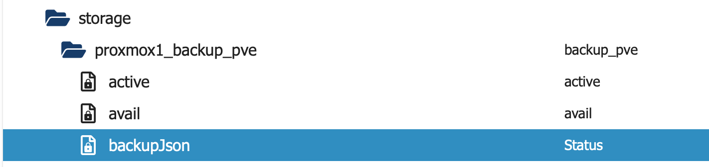

# ioBroker.proxmox

## Anforderungen
- Node.js 22.19 (oder neuer)
- js-controller 6.0.11 (oder neuer)
- Admin Adapter 7.7.22 (oder neuer)  
  
***  
>Die Dokumentation basiert auf dem Stand der Version 2.4.0  
Alle Bilder sind Beispiele und können je nach Systemkonfiguration abweichen.

## Nodes

  
  
### Anfrage-Intervall  
Standard sind 30 Sekunden. Der kleinste Wert sind 5 Sekunden.  
  
> Mit klicken auf das Plussymbol wird eine neue Zeile für ein Node hinzugefügt. in einer Insatnnz können alle Nodes eingetragen werden.  
  
### IP Adresse 
Die IP Adresse des Proxmox Server bzw. der Servername.
  
### Port  
Standard ist der Port 8006, wenn bei der Installation ein anderer Port eingestell wurde, muss dieser hier auch geändert.  

### Nutzername  
Bei der Installation wird root als Standard eingestellt. Wenn ein neuer User für den Abruf der Daten in Proxmox erstellt wird, kommt hier sein Loginname rein.  
  
### Passwort  
Passwort vom root bzw. vom neu erstellten User.  

### Realm
Auswahl zwischen `Standard Authentifizierung` und dem `Proxmox Authentifizierungsserver`.  
Als Standard sollte hier der selbe Dienst gewählt werden, wie im Login auf der Weboberfläche.  
  
  
***
## Weitere Informationen  
    
### Festplatten Informationen
Bei der Auswahl werden in den Objekten diese Datenpunkte angelegt, diese können sich je nach Festplattentyp unterscheiden.  
  
  
### HA informationen  
Es werden alle Nodes des HA-Cluster aufgelistet. Welcher Node Master ist und welcher das Quorum übernimmt.  
    

### Ceph Informationen  
in Arbeit  

### neue Baumstruktur  
Bei der neuen Baumstruktur werden `LXC Container` und `VM` unter einen Hauptordner gesammelt.  
  
alte Struktur  
  
  
neue Struktur    
  
  
### Speicher Informationen / storage information
Hiermit werden die Informationen zu den verwendeten Speichertypen hinterlegt. 
  
  
### Backup Informationen
Es wird der Datenpunkt `backupJSON` unter den einzelnen Speicher / Storage angelegt.  
Hier im Beispiel des Backup-Speichers werden in dem JSON die Backups gelistet, welche in Proxmox konfiguriert wurden.  
  

zum Beispiel
```json
  "backup_pve:backup/vzdump-lxc-100-2024_12_24-03_00_03.tar.zst": {
    "subtype": "lxc",
    "format": "tar.zst",
    "volid": "backup_pve:backup/vzdump-lxc-100-2024_12_24-03_00_03.tar.zst",
    "ctime": 1735005603,
    "notes": "iobDev, 100",
    "vmid": 100,
    "content": "backup",
    "size": 3486489024
  },
  "backup_pve:backup/vzdump-lxc-100-2024_12_25-03_00_00.tar.zst": {
    "size": 3487399986,
    "notes": "iobDev, 100",
    "content": "backup",
    "vmid": 100,
    "format": "tar.zst",
    "volid": "backup_pve:backup/vzdump-lxc-100-2024_12_25-03_00_00.tar.zst",
    "ctime": 1735092000,
    "subtype": "lxc"
  },
  "backup_pve:backup/vzdump-lxc-100-2024_12_26-03_00_02.tar.zst": {
    "size": 3486595678,
    "content": "backup",
    "vmid": 100,
    "notes": "iobDev, 100",
    "ctime": 1735178402,
    "volid": "backup_pve:backup/vzdump-lxc-100-2024_12_26-03_00_02.tar.zst",
    "format": "tar.zst",
    "subtype": "lxc"
  },
```

### Verfügbare Updates
Mit der Option **Verfügbare Updates abfragen** liest der Adapter die verfügbaren Paket-Updates (apt) jedes Nodes, der online ist.
Das geschieht in der ersten Abfrage nach dem Start und danach im eingestellten Intervall (Standard 60 Minuten, mindestens 10 Minuten).

| State | Beschreibung |
| --- | --- |
| `node_<name>.updates.count` | Anzahl der verfügbaren Updates |
| `node_<name>.updates.list` | Die Updates als JSON, zum Beispiel `[{"package": "pve-manager", "oldVersion": "9.0.1", "version": "9.0.2", "origin": "Proxmox"}]` |
| `node_<name>.updates.refresh` | Button: aktualisiert die Paketliste des Nodes (wie `apt-get update`) und liest die Updates neu |

Proxmox aktualisiert die Paketliste selbst einmal am Tag. Den Button braucht es nur, wenn neue Updates sofort erscheinen sollen.
Im Device Manager stehen die Updates in den Details eines Nodes.

Benötigte Rechte des Proxmox-Benutzers auf `/nodes/<name>`: `Sys.Audit` zum Lesen, `Sys.Modify` für den Button.

Erkannt werden nur die Updates des Proxmox-Hosts. Was in einem Container oder einer VM installiert ist, liefert die Proxmox-API nicht.

## vis-2-Widget

Der Widget-Satz „Proxmox“ enthält ein Widget für eine VM oder einen Container. Wähle die Maschine aus der Liste aus. Das Widget zeigt Zustand, Laufzeit, CPU und RAM und hat Tasten zum Starten und Stoppen.

- **Laufzeit anzeigen:** Die Laufzeit erscheint, solange die Maschine läuft.
- **Symbol anzeigen:** Die Farbe des Symbols zeigt den Zustand. Unter **Icon** kannst du ein eigenes Icon wählen, unter **Bild** eine eigene Bilddatei. Ein Bild hat Vorrang vor dem Icon und behält seine eigenen Farben.
- **Steuerung anzeigen:** Ohne diese Option zeigt das Widget nur den Zustand an. Das ist sinnvoll, wenn ein vis-Projekt für Personen erreichbar ist, die keine Maschinen stoppen sollen. Die Rückfrage ist kein Zugriffsschutz.
- **Stopp-Taste:** Standardmäßig fährt sie die Maschine sauber herunter. „Sofort ausschalten“ nutzt den Proxmox-Befehl `stop`, dabei können nicht gespeicherte Daten verloren gehen.
- Nach einem Befehl aktualisiert sich der Zustand mit der nächsten Abfrage, also nach etwa 10 Sekunden. Bis dahin zeigt das Widget „Wird ausgeführt“.
